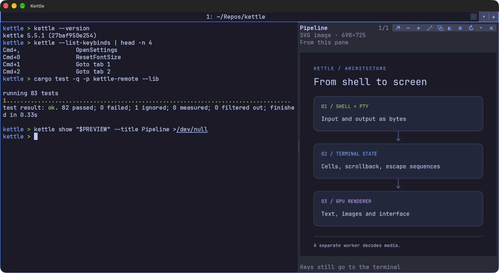
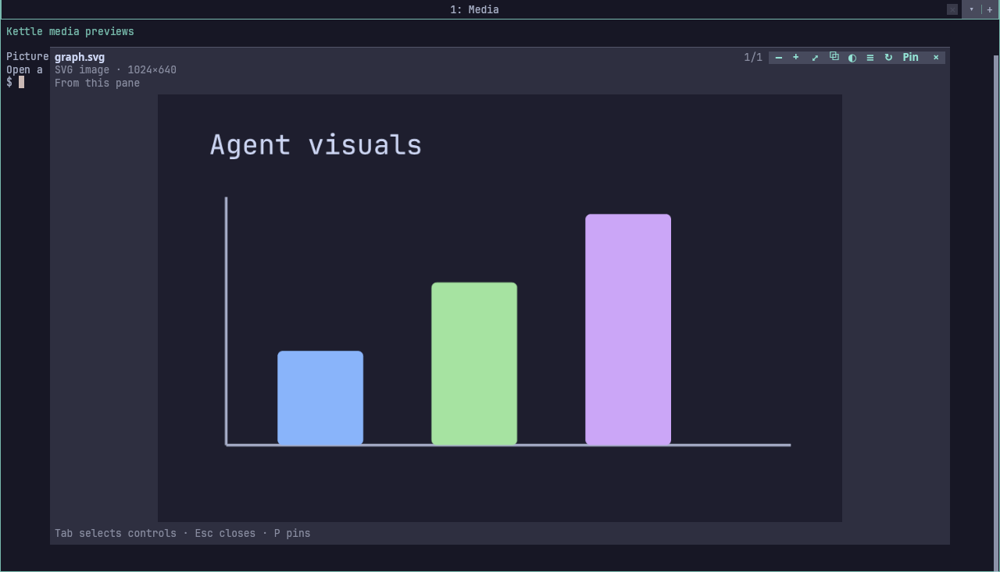

# kettle 🫖

[](https://github.com/Reddimus/kettle/actions/workflows/ci.yml)
[](https://github.com/Reddimus/kettle/actions/workflows/audit.yml)
[](https://github.com/Reddimus/kettle/releases/latest)
[](Cargo.toml)
[](LICENSE)

Kettle is a GPU-accelerated terminal for macOS and Linux. It has tabs, splits,
search, session restore and themes, and it shows the pictures, diagrams,
documents and videos your coding agents make right in the chat.



Native macOS window, TokyoNight Night. [Capture notes](docs/images/README.md).

## Install

| Platform | Download from the [latest release](https://github.com/Reddimus/kettle/releases/latest) | Setup |
| --- | --- | --- |
| macOS 11+ | `kettle-macos-universal.zip` | Move `kettle.app` to `~/Applications` |
| Linux, glibc 2.35+ | `kettle-linux-*.tar.gz` | Run the installer below |

The Linux installer puts Kettle under `~/.local` for your user and checks the
release signature first. Neither package needs administrator access.

```sh
curl -fsSL https://raw.githubusercontent.com/Reddimus/kettle/main/scripts/install-online.sh | sh
```

[Installation](docs/INSTALL.md) covers Nix, older Linux systems, source
builds and uninstalling. Windows packages ended with 3.3.0
([older releases](docs/VERSION-HISTORY.md)).

Kettle updates itself: by default it checks the signed release feed once a
day and installs a newer release for your next launch. Run
`kettle --check-update` to check now, or set `update-policy = notify` (a chip
in the tab bar only) or `update-policy = off` (no automatic network request).

## Get started

1. Open Kettle from your app launcher, or run `kettle`.
2. Split the window with `Ctrl+Shift+E` (side by side) or `Ctrl+Shift+O`
   (top and bottom).
3. Open Settings with `Ctrl+,`.
4. Optional: add [shell integration](docs/SHELL-INTEGRATION.md) for prompt
   jumps and completion cards.

Kettle reloads its `key = value` config when you save it.
`kettle --write-default-config` creates one, `kettle --config-path` finds it
and `kettle --check-config` validates it. [Configuration](docs/CONFIG.md)
lists every setting.

## Common keys

| Action | Key |
| --- | --- |
| New tab | `Ctrl+Shift+T` |
| Split left or right | `Ctrl+Shift+E` |
| Split top or bottom | `Ctrl+Shift+O` |
| Focus next or previous pane | `Ctrl+Shift+N` or `Ctrl+Shift+P` |
| Focus the pane in a direction, Linux | `Alt+Arrow` |
| Focus the pane in a direction, macOS | `Cmd+Opt+Arrow` or `Ctrl+Cmd+Arrow` |
| Search | `Ctrl+Shift+F` |
| Command palette | `Ctrl+Shift+K` |
| Copy or paste | `Ctrl+Shift+C` or `Ctrl+Shift+V` |
| Settings | `Ctrl+,` |

macOS also has `Cmd+T`, `Cmd+C/V`, `Cmd+F` and `Cmd+,`. Run
`kettle --list-keybinds` for the full map, and see
[Getting started](docs/GETTING-STARTED.md) for more.

## Agent previews

Claude Code and Codex running in a Kettle pane can show you images, SVG and
Mermaid diagrams, charts and video posters as cards under their messages.
Turn on **Settings → Agents → Agent previews**, then the previews for your
agent:

- **Claude Code**: new panes load Kettle's plugin. No setup, no prompts.
- **Codex**: Kettle defines a `codex` shell function in new zsh and fish
  panes. Codex asks in its own dialog before trusting Kettle's hooks. A
  prompt hook supplies visual guidance. A turn-end fallback checks only the
  session's private visual artifact inbox, giving the agent time to show the
  artifact itself first. It never watches your repository.
- **agy**: enable agy previews, then run
  `kettle agent-setup --agent agy --install`. The native plugin supplies visual
  guidance and sends explicit visual artifacts to the media shelf on macOS.
  agy's hooks do not support Kettle's inline cards; its own Mermaid rendering
  remains available. Requires agy 1.4.2 or newer within 1.x.
- **Any program**: `kettle show plot.png` (or `.svg`, `.md`, `.mp4`, `.pdf`,
  `.heic`) puts a file on the pane's media shelf, and `kettle show --inline`
  prints its card right under the command. A file Kettle does not draw shows
  as a card you can open in its folder. `kettle ctl schema` prints the JSON
  Schema of the control API that `kettle ctl` drives.

Click a card to open its viewer within 90% of its split, with padding on every
side. Videos fit the available space and offer a central Play button and
controls below the picture, with compact white icons on a dark strip and a
thin timeline in the theme accent. Hover or drag the timeline to reveal its
round seek handle; narrow players keep time on a separate line. Click the
video or press K to play/pause, T for a larger Theater view, and F for
fullscreen. Press Esc to close or **Pin** to keep it beside the terminal.
Right-click the preview for copy, zoom, page and playback options.
Video plays only on your play gesture. On Linux, sound needs FFmpeg and
PulseAudio or PipeWire.

Inline cards support Codex 0.162 and newer within 0.x, and native Claude Code
2.1.280 and newer within 2.x. Support for a new major version needs a
compatibility review.



[Automation and MCP](docs/AGENT.md) explains supported versions, what each
setting allows, and the local control API.

## Features

- Tabs, splits, multiple windows, and tabs you can drag between windows
- Centered close confirmations with Cancel focused to protect running work
- Search, bounded scrollback, broadcast input and session restore
- Inline images (kitty, iTerm2 and Sixel), file drop and pasted screenshots
- Shell-driven completion cards, recording and SSH profiles
- A bundled font and more than 500 themes, in English or Spanish
- Signed self-updates
- An optional local control API and MCP server, both off by default

## Privacy

Pasting media sends a quoted local path to the pane, never the file. The
control API and MCP server are off by default; once on, any process running
as your user can use them, and `full` mode can type and run commands. Read
[Automation and MCP](docs/AGENT.md) before turning them on.

## Contributing

Building Kettle requires Rust 1.95 or newer and
[just](https://github.com/casey/just). Linux also needs the packages listed
under [source builds](docs/INSTALL.md#from-source).

```sh
git clone https://github.com/Reddimus/kettle
cd kettle
just run        # build and open Kettle
just test       # run the test suite
just gauntlet   # the checks to pass before a pull request
```

[Contributing](CONTRIBUTING.md) describes the workflow, and
[Testing](docs/TESTING.md) the larger gates.

## Documentation

- [Getting started](docs/GETTING-STARTED.md), [Installation](docs/INSTALL.md)
  and [Updates](docs/UPDATES.md)
- [Configuration](docs/CONFIG.md) and [Settings](docs/SETTINGS.md)
- [Shell integration](docs/SHELL-INTEGRATION.md),
  [Automation and MCP](docs/AGENT.md) and [Lua plugins](docs/PLUGINS.md)
- [Architecture](docs/ARCHITECTURE.md), [Testing](docs/TESTING.md) and
  [Releasing](docs/RELEASING.md)
- [Security](SECURITY.md) and [Changelog](CHANGELOG.md)

## License

Kettle is available under the [MIT license](LICENSE). Third-party code, assets
and design references are listed in [NOTICE](NOTICE).
