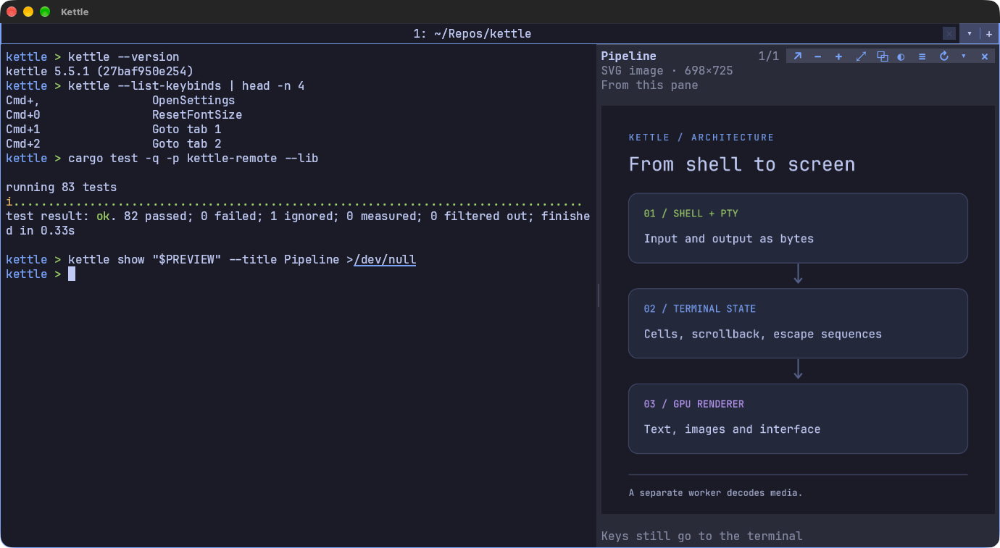
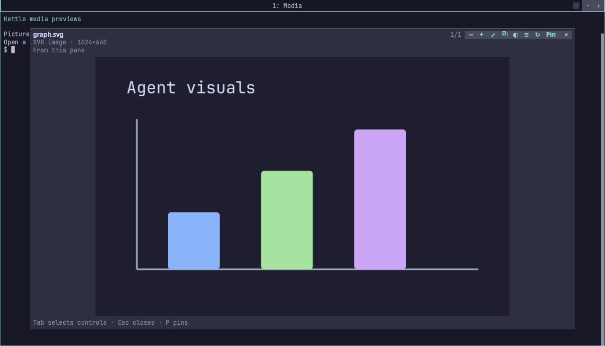

# kettle 🫖

[](https://github.com/Reddimus/kettle/actions/workflows/ci.yml)
[](https://github.com/Reddimus/kettle/actions/workflows/audit.yml)
[](https://github.com/Reddimus/kettle/releases/latest)
[](Cargo.toml)
[](LICENSE)

Kettle is a GPU-accelerated terminal for macOS and Linux. It has tabs, splits,
search, session restore and themes, and it shows the pictures, diagrams,
documents and videos your coding agents make right in the chat.

Use `kettle quick-terminal` for a persistent hotkey window; configure it in Settings → Quick terminal.



Native macOS window, TokyoNight Night. [Capture notes](docs/images/README.md).
On macOS, top tabs now share the titlebar; `macos-titlebar-style = native`
restores the separate native caption.

On GNOME/Wayland, Kettle draws a 46 logical pixel header with the window title,
tabs and minimize/maximize/close controls. Empty header space moves the window,
double-click maximizes, and right-click opens the compositor's window menu.
Other desktops (KDE, wlroots compositors) and X11 keep their own frames. Set
`linux-titlebar-style = native` for winit's previous titleless Adwaita header;
see [configuration](docs/CONFIG.md) for borderless and tab-position behavior.

## Install

| Platform | Download from the [latest release](https://github.com/Reddimus/kettle/releases/latest) | Setup |
| --- | --- | --- |
| macOS 11+ | `kettle-macos-universal.zip` | Move `kettle.app` to `~/Applications` |
| Linux, glibc 2.35+ | `kettle-linux-*.tar.gz` | Run the installer below |

The Linux installer puts Kettle under `~/.local` for your user and checks the
release signature first. Neither package needs administrator access.

```sh
curl -fsSL https://raw.githubusercontent.com/Reddimus/kettle/main/scripts/install-online.sh | sh
```

[Installation](docs/INSTALL.md) covers Nix, older Linux systems, source
builds and uninstalling. Windows packages ended with 3.3.0
([older releases](docs/VERSION-HISTORY.md)).

Kettle updates itself: by default it checks the signed release feed once a
day and installs a newer release for your next launch. Run
`kettle --check-update` to check now, or set `update-policy = notify` (a brief
update toast) or `update-policy = off` (no automatic network request).

## Get started

1. Open Kettle from your app launcher, or run `kettle`.
2. Split the window with `Ctrl+Shift+E` (side by side) or `Ctrl+Shift+O`
   (top and bottom).
3. Open Settings with `Ctrl+,`.
4. Bash, Zsh and Fish get [shell integration](docs/SHELL-INTEGRATION.md)
   automatically for prompt jumps, command results and completion cards.
   macOS system Bash 3.2 needs the linked manual setup.

Kettle reloads its `key = value` config when you save it.
`kettle --write-default-config` creates one, `kettle --config-path` finds it
and `kettle --check-config` validates it. [Configuration](docs/CONFIG.md)
lists every setting. Config problems appear in a translated notice with source
lines, reasons and spelling suggestions, without showing values. Choose
**Open Config** to edit that file, or use the notice's dismiss button. If a
screen reader moves focus to the notice, Enter opens the config and Escape
dismisses it. While the terminal retains focus, those keys go to the running
shell or program.

## Common keys

| Action | Key |
| --- | --- |
| New tab | `Ctrl+Shift+T` |
| Split left or right | `Ctrl+Shift+E` |
| Split top or bottom | `Ctrl+Shift+O` |
| Focus next or previous pane | `Ctrl+Shift+N` or `Ctrl+Shift+P` |
| Focus the pane in a direction, Linux | `Alt+Arrow` |
| Focus the pane in a direction, macOS | `Cmd+Opt+Arrow` or `Ctrl+Cmd+Arrow` |
| Zoom the focused pane, or restore the split | `Ctrl+Shift+X` |
| Search | `Ctrl+Shift+F` |
| Toggle regex while searching | `Alt+R` (Linux/Windows), `Cmd+Alt+R` (macOS) |
| Command palette | `Ctrl+Shift+K` |
| Copy or paste | `Ctrl+Shift+C` or `Ctrl+Shift+V` |
| Settings | `Ctrl+,` |

A zoomed pane keeps its titlebar, which shows how many panes the zoom hides
and the key that restores them.

macOS also has `Cmd+T`, `Cmd+D` and `Shift+Cmd+D` (split beside and
below), `Cmd+C/V`, `Cmd+F` and `Cmd+,`. Run
`kettle --list-keybinds` for the full map, or choose **Keyboard Shortcuts** in
the macOS Help menu or **Keyboard shortcuts** in the new-tab **▾** menu: the
command palette then lists only the commands that have a shortcut, with the
shortcut beside each, and you can search it and press Enter to run one. The
macOS Shell, Edit, View and Window menus expose common actions and show their
current Cmd shortcuts, including config overrides. See
[Getting started](docs/GETTING-STARTED.md) for more.

## Selecting text

- Drag to select text. Double-click selects a word or detected path; triple-click
  selects a line. Drag past the top or bottom to scroll through history.
- **Option-drag on macOS / Alt-drag elsewhere** selects a rectangular block.
- **Shift-click** extends the existing selection from its anchor; keep dragging
  to adjust the end. Without a selection it starts one. Shift also bypasses a
  terminal application's mouse reporting so you can select text there;
  Shift+Option/Alt-drag starts a block.
- **Shift-right-click** off an existing selection extends it to the pointer;
  right-click on it opens its context menu.
- **Cmd-click or Ctrl-click** opens a detected link (`link-single-click = true`
  also permits an unmodified click).

Releasing a drag copies the selection by default (`copy-on-select = true`).
Copy explicitly with **Cmd+C on macOS / Ctrl+Shift+C elsewhere**, the Copy menu
item, or vi-mode yank. With no selection, explicit copy keeps the clipboard
unless `smart-copy = false`. Linux automatic copy also updates PRIMARY
for middle-click paste. Double- and triple-click selections copy immediately.

Copy drops trailing whitespace at the end of each copied line
(`copy-trim-whitespace = true`). Set it to `false` to copy the selection exactly
as displayed, including trailing spaces and block padding. Stream selections join soft-wrapped lines; rectangular blocks
copy each row's column slice on its own line. Settings > Behavior exposes the
copy controls and selection modifiers. Settings > Appearance changes cursor
shape, blinking and the unfocused style immediately. An unfocused window uses
a neutral selection and, by default, a steady hollow cursor; an application
that hides its cursor keeps it hidden.

## Pasting

Use the Paste shortcut (Cmd+V on macOS, Ctrl+Shift+V on Linux). With
`paste-protection = auto`, Kettle asks before text containing line breaks or
control characters reaches any writable recipient without bracketed paste,
and before text that tries to end bracketed paste early (`ESC [201~`).
`always` asks for every multiline paste, including bracketed paste; `off`
disables confirmation. The dialog reports the line count, escape sequences
and other controls, and previews up to three lines with controls drawn visibly
(for example, ␛, ␇ and ^X). Long previews are truncated.

- **Paste** sends the original text through the normal paste rules.
- **Paste as one line** replaces CRLF, CR, LF and ASCII controls other than
  TAB with spaces. It keeps tabs; escape-sequence payload text can remain.
- **Paste Without Controls**, offered when controls are present, removes C0
  controls other than TAB/LF/CR, DEL and C1 controls, plus whole ESC, CSI and
  OSC sequences (including control strings). It preserves tabs and line breaks.
  An unterminated sequence is removed through the end of the paste.
- **Cancel** sends nothing and has focus initially.

Bracketed paste wraps the text so a supporting program can treat it as data.
Kettle strips every embedded ESC byte inside that wrapper, even after choosing
Paste, so clipboard text cannot end the wrapper early. Within the wrapper LF
stays LF and CRLF becomes LF; without it, line endings become CR for terminal
input. Removing controls does not make pasted shell commands safe to run.

With `paste-files = on` (default), copied files paste their existing local
paths, quoted for the pane's shell. `paste-files = off` ignores copied file
references and uses text instead; explicit drops still paste paths. Kettle
does not upload the files or change their lifetime.
With `paste-images = on` (the default), a clipboard bitmap becomes a private
PNG such as `$TMPDIR/kettle-paste-*/0001.png` in an owner-only directory
under the OS temporary directory
(on Windows, under per-user Local App Data). Its quoted local path is written
to the pane. Kettle keeps the PNG until exit, with a per-session limit of 64 PNGs and
256 MiB; a bounded startup sweep removes stale sessions left by a dead
process. A remote shell cannot read a local file merely from its path.

An accepted bitmap path shows a short-lived receipt card with a thumbnail;
its body opens the retained image in Kettle without typing more text. Copied
or dropped videos can show an informational receipt. `paste-image-preview`
and `paste-video-preview` disable these cards. A new media paste replaces the
previous receipt, and later input removes it; closing the card does not delete
the retained PNG.

On Linux, Wayland text copy and paste use the window's Wayland connection,
including on GNOME without XWayland. Middle-click uses PRIMARY when the
compositor supports the primary-selection protocol. Text access requires the
window to have focus. Images and explicit file lists still use arboard's X11
backend in this build: without XWayland they are unavailable, image paste logs
the limitation and falls through to text, and drag and drop remains available.
No clipboard configuration change is needed.

Programs can use OSC 52 to access the clipboard. `osc52 = copy` (default)
allows writes and denies reads; `off` denies both, `paste` allows reads only,
and `both` allows both. Allowing reads lets a remote program obtain clipboard
contents. Successful writes show "A program copied N characters to the
clipboard" at most once every five seconds per pane, counting Unicode code
points after the size limit and internal-marker removal. Set
`osc52-notify = false` to silence successful-write notices. Blocked reads and
writes each show one notice per pane explaining the `osc52` policy key.
Notices are dismissible and contain no clipboard text.

**Accessibility:** the paste confirmation exposes an alert dialog, its full
message and every button to screen readers. Tab and Shift+Tab cycle choices;
arrows move between them, Enter activates the focused choice and Esc cancels.
With `vim-menu-nav`, Y chooses Paste, N cancels, and H/L move focus. The
confirmation has no editable field or IME caret. OSC 52 notices are polite
screen-reader status announcements with a Dismiss action.

## Agent previews

Claude Code and Codex running in a Kettle pane can show you images, SVG and
Mermaid diagrams, charts and video posters as cards under their messages.
Turn on **Settings → Agents → Agent previews**, then the previews for your
agent:

- **Claude Code**: new panes load Kettle's plugin. No setup, no prompts.
- **Codex**: Kettle defines a `codex` shell function in new zsh and fish
  panes. Codex asks in its own dialog before trusting Kettle's hooks. A
  prompt hook supplies visual guidance. A turn-end fallback checks only the
  session's private visual artifact inbox, giving the agent time to show the
  artifact itself first. It never watches your repository.
- **agy**: enable agy previews, then run
  `kettle agent-setup --agent agy --install`. The native plugin supplies visual
  guidance and sends explicit visual artifacts to the media shelf on macOS.
  agy's hooks do not support Kettle's inline cards; its own Mermaid rendering
  remains available. Requires agy 1.4.2 or newer within 1.x.
- **Any program**: `kettle show plot.png` (or `.svg`, `.md`, `.mp4`, `.pdf`,
  `.heic`) puts a file on the pane's media shelf, and `kettle show --inline`
  prints its card right under the command. A file Kettle does not draw shows
  as a card you can open in its folder. `kettle ctl schema` prints the JSON
  Schema of the control API that `kettle ctl` drives.

Click a card to open its viewer within 90% of its split, with padding on every
side. Videos fit the available space and offer a central Play button and
controls below the picture, with compact white icons on a dark strip and a
thin timeline in the theme accent. Hover or drag the timeline to reveal its
round seek handle; narrow players keep time on a separate line. Click the
video or press K to play/pause, T for a larger Theater view, and F for
fullscreen. Press Esc to close or **Pin** to keep it beside the terminal.
Right-click the preview for copy, zoom, page and playback options.
Video plays only on your play gesture. On Linux, sound needs FFmpeg and
PulseAudio or PipeWire.

Inline cards support Codex 0.162 and newer within 0.x, and native Claude Code
2.1.280 and newer within 2.x. Support for a new major version needs a
compatibility review.



[Automation and MCP](docs/AGENT.md) explains supported versions, what each
setting allows, and the local control API.
Use `kettle agent-setup --status` to check which command runs first. The
[wrapper forms](docs/AGENT.md#wrapping-your-own-claude-or-codex-function)
let your function keep its account environment and call Kettle's launcher.

## Sessions, profiles and layouts

Session restore keeps windows, tabs, split arrangements and working directories,
and each pane's recent output: up to `restore-scrollback-lines` lines (1,000 by
default, `0` turns it off), shown faint above a **Restored** divider and a fresh
shell. Output from remote panes is left out unless `restore-scrollback-remote =
true`. The saved text is private to your account and is never sent as input.
Running processes are not restored: shells and saved commands start again; see
[session restore](docs/SESSION-RESTORE.md). With `restore-session = auto` (the default), macOS
restores when **Close windows when quitting an application** is unchecked;
if the system has no preference set, it keeps windows. Linux restores with
`auto`, as Ptyxis does; Windows opens fresh. Use `true` or `false` to choose
explicitly.

Open the new-tab **▾** menu beside **+** (set `tab-bar = always` to keep it
visible with one tab), or the macOS **Shell** menu:

- **New Tab with Profile** lists the same profiles as `kettle --list-profiles`.
  Each choice opens a separate Kettle process/window with that profile, since
  profiles include application-wide settings. The empty **Create Profile…**
  action creates and opens the profiles directory; add a `NAME.config` file
  there, for example a copy of your config. Profiles live in the default
  config directory's `profiles/`, even with `--config FILE`.
- **Save Layout…** asks for a name and saves the current windows, tabs, splits
  and working directories. **Open Layout…** opens the searchable picker and
  launches the selected arrangement in a separate process. Saving an existing
  name replaces that layout. Layouts live in the default config directory's
  `layouts/`. Quick-terminal windows are excluded.
- **SSH launcher** opens configured SSH hosts or accepts a typed target.

The command palette (`Ctrl+Shift+K`) offers these actions, one launch entry per
profile, and **Broadcast input…** actions for all panes in the tab, a group or the
window. Broadcast sends input to multiple panes; choose **Stop broadcasting
input** when finished. Profiles and
layouts can also be selected with `--profile NAME` and `--layout NAME`.
See [configuration](docs/CONFIG.md) and [getting started](docs/GETTING-STARTED.md).

## Features

- Tabs, splits, multiple windows, and tabs you can drag between windows
- Centered close confirmations with Cancel focused to protect running work
- Search, bounded scrollback, broadcast input and session restore
  (windows, tabs, splits, working directories and up to 1000 recent output lines
  per pane survive a relaunch when restore is enabled). Output is stored in
  private files, capped at 8 MiB total; remote output is opt-in. See
  [session restore](docs/SESSION-RESTORE.md) for privacy and limits.
- Inline images (kitty, iTerm2 and Sixel), file drop and pasted screenshots
- Shell-driven completion cards, recording and SSH profiles
- A bundled font and more than 500 themes, in English or Spanish
- Signed self-updates
- An optional local control API and MCP server, both off by default

## Links and quick-select hints

Hover a link to highlight it and see its destination and opening gesture.
The hovered link uses a solid accent underline and a hand cursor. At rest,
detected URLs and paths have no underline, so a screen full of them stays
quiet; `link-underline = always` gives them a thin, dim one. Explicit OSC 8
links always rest with a dotted underline. Inside a selection or search match
an underline keeps its shape but is drawn thin in the colour of the text above
it, so it does not compete with the highlight. A hovered link that is partly
selected keeps its resting look, and dragging a selection hovers no links.
The destination pill moves away from the link and disappears when you leave,
scroll, type, or change focus.
`link-single-click` changes its gesture from Cmd-click (macOS) or Ctrl-click
to a plain click.

Press **Ctrl+Shift+H**, choose **Quick-select hints** in the command palette or
macOS Edit menu, or use that entry in the terminal context menu when links or
paths are visible. Type a label to open a URL or copy other text. Hold Shift
while completing a label to copy a URL or open a local path; inline cards open
their preview. The legend shows the available actions and **Esc** cancels.
Labels use the shortest prefix-free codes, with easy keys nearest the bottom.
They sit in blank cells before matches when possible. At column zero they use
blank cells after the match when available; otherwise they overlay its start.
Paths need path context: progress counters such as `158/158`, ratios such as
`a/b` and slash-joined words such as `read/write` stay plain text; a relative
path counts as a link (shown on hover and offered as a hint) when its last part
has an extension or it has three parts. Remote or unresolved paths are copied;
see [configuration and hint actions](docs/CONFIG.md).

## Themes

Kettle follows the system's light/dark appearance by default, with Kettle Day
(TokyoNight Day with darker text) and TokyoNight Night. Existing configs with
`theme` and no `theme-mode` keep their fixed theme. Settings → Appearance
offers Follow system, Light, Dark and Fixed theme. Choosing a theme while
following the system saves it for the active appearance. Linux uses the XDG
Settings portal; if appearance is unavailable or has no preference, Kettle
uses dark.
See [theme configuration](docs/CONFIG.md#auto-lightdark-theme-switching).

## Privacy

Pasting media sends a quoted local path to the pane, never the file. The
control API and MCP server are off by default; once on, any process running
as your user can use them, and `full` mode can type and run commands. Read
[Automation and MCP](docs/AGENT.md) before turning them on.

## Contributing

Building Kettle requires Rust 1.95 or newer and
[just](https://github.com/casey/just). Linux also needs the packages listed
under [source builds](docs/INSTALL.md#from-source).

```sh
git clone https://github.com/Reddimus/kettle
cd kettle
just run        # build and open Kettle
just test       # run the test suite
just gauntlet   # the checks to pass before a pull request
```

[Contributing](CONTRIBUTING.md) describes the workflow, and
[Testing](docs/TESTING.md) the larger gates.

## Documentation

- [Getting started](docs/GETTING-STARTED.md), [Installation](docs/INSTALL.md)
  and [Updates](docs/UPDATES.md)
- [Configuration](docs/CONFIG.md) and [Settings](docs/SETTINGS.md)
- [Shell integration](docs/SHELL-INTEGRATION.md),
  [Automation and MCP](docs/AGENT.md) and [Lua plugins](docs/PLUGINS.md)
- [Architecture](docs/ARCHITECTURE.md), [Testing](docs/TESTING.md) and
  [Releasing](docs/RELEASING.md)
- [Security](SECURITY.md) and [Changelog](CHANGELOG.md)

## License

Kettle is available under the [MIT license](LICENSE). Third-party code, assets
and design references are listed in [NOTICE](NOTICE).
