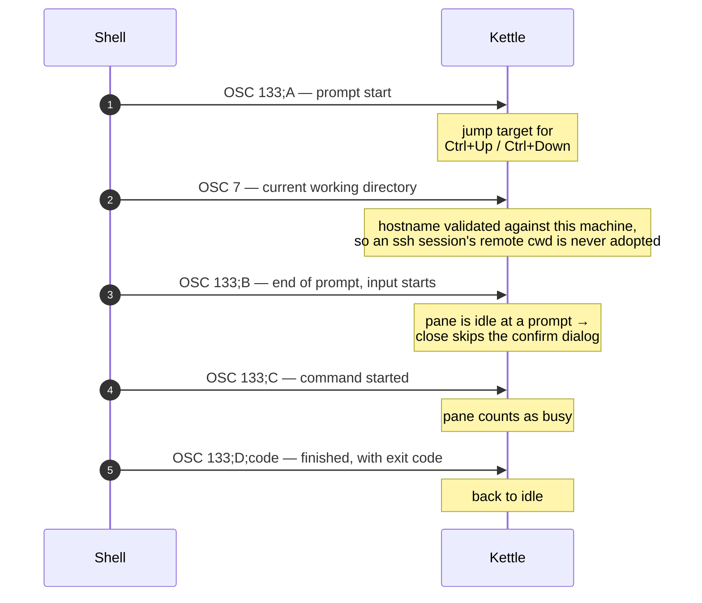

# Shell integration (OSC 133)

Kettle understands **OSC 133** prompt marks. When your shell emits them, Kettle
records where each prompt started so you can jump
between commands:

| Action | Default bind |
|---|---|
| Jump to previous prompt | `Ctrl+Up` |
| Jump to next prompt | `Ctrl+Down` |

(Rebind with `keybind = ctrl+up=prev_prompt` / `next_prompt`.)

The right-click menu offers the same jumps as **Previous Prompt** and **Next
Prompt**, after **Find…**, once the pane has a prompt mark. Each row shows
only while a jump that way would move the view, with its current chord beside
it.

Marks are parsed out of the PTY stream ahead of the VT engine, so they never
corrupt the screen even on terminals/apps that don't understand them.

## Automatic integration

`shell-integration = auto` is the default on macOS and Linux. Open a pane
with bash, zsh or fish and Kettle loads its bundled hooks without editing your
startup files. `off` disables injection; the older boolean values still work.
This supplies OSC 7 working directories and OSC 133 prompt and command marks.
Previous/next-prompt navigation keeps its existing bindings and behavior.

- Zsh reads checked, private startup files through a borrowed `ZDOTDIR`.
  Each sources your corresponding startup file once; Kettle's hooks load after
  your last startup file (`.zlogin` for login shells, `.zshrc` otherwise).
  Your original `ZDOTDIR` (including unset or empty) is restored.
  A system zshenv that overrides `ZDOTDIR` or disables startup files prevents
  injection; use the manual snippet in that case.
- Bash uses `--posix` with a private `ENV` startup file and `--login` for
  login panes. A separate variable holds the private pathname so Bash cannot
  expand literal `$` or command substitutions in directory names. An unavailable
  startup file at launch leaves Bash untouched. The wrapper turns POSIX mode
  off, preserves an inherited `BASHOPTS=inherit_errexit`, restores your `ENV`, then
  sources `/etc/profile` and the first readable `.bash_profile`, `.bash_login`
  or `.profile` for login shells. Nonlogin interactive panes source the first
  readable `/etc/bash.bashrc` or `/etc/bash/bashrc`, then `.bashrc` or
  `--rcfile`'s file (including a leading `~` or `~/`). Kettle does not source
  `/etc/bashrc`; Fedora's personal `.bashrc` sources it. It honors `--noprofile`
  and `--norc`, then loads Kettle's hooks. Explicit `--posix`, a set
  `POSIXLY_CORRECT`, or `SHELLOPTS` containing `posix` leaves Bash untouched.
  Login state and `.bash_logout` processing stay native. macOS system Bash
  3.2.57 ignores this `ENV` route, so Kettle launches it untouched; use the
  manual snippet below or a separately installed modern Bash for hooks.
- Fish discovers a private `vendor_conf.d` file through `XDG_DATA_DIRS`.
  That file removes only Kettle's entry from the current value, preserving
  edits by earlier user snippets such as `conf.d/00-env.fish`. It clears
  Kettle's exported helpers and loads hooks at the first prompt, after user
  configuration. Earlier snippets run before this cleanup boundary.

The files are private, checked for ownership, permissions and exact contents,
and never added to your startup files. Zsh wrappers also load compiled-only
`.zwc` startup files. Content-addressed variants used within 24 hours remain
available to starting shells; cleanup retains up to four older variants.
A bare `command = bash`, `zsh` or `fish` also works. Bash additionally accepts
startup-only `-l`, `--login`, `--noprofile`, `--norc`, `--rcfile` and `--init-file`
arguments. Scripts, other arguments and wrappers remain exact and need manual
setup. Panes already open keep their existing hooks. If private files cannot
be prepared safely, Kettle starts the shell without automatic hooks.

The old Windows PowerShell bootstrap remains available in source; Windows
releases ended in 3.3.0. WSL shells need manual setup inside their distribution.

## Completed-command marks

Completed commands with an OSC 133 D exit status leave a tick along the right
edge of the terminal, over the scrollbar track: a thin green tick for success
(exit code 0), a thicker red tick for failure. Ticks remain visible when the
scrollbar thumb is hidden. Screen readers describe each tick and its exit code
in the selected UI language. `kettle ctl ui_geometry` reports the same tick
rectangles and exit codes in each pane's `command_marks` array. They do not
move the grid, input-method caret or selection coordinates.

Unknown exit status and unmatched or duplicate completion events add no tick.
Marks are limited to 2048 retained commands per pane, disappear when their rows
leave scrollback, and stay hidden on the alternate screen. Column reflow clears
outcomes whose original row positions can no longer be trusted.

## Selecting a command's output

**Select Command Output** selects one finished command's output as whole rows,
ready to copy: from the row after the command line, where OSC 133 C arrives,
up to the row where D arrives and the next prompt starts. A cursor past the
first column at C or D counts its row with the command line or the output, so
output without a final newline is included. Right-click a row of a command's
output and the menu offers it after **Select All**; the command palette's
**Select output of last command**, or the `select_command_output` action bound
to a chord, takes the newest command. No platform binds it by default, so
programs keep their chords: bind one with
`keybind = ctrl+alt+o=select_command_output`. When the first output row is
above the view, the view scrolls to put it at the top.

There is nothing to select for a command without C, one that printed nothing,
one whose rows a scroll region split, or on the alternate screen. The output
rows are kept with the command's mark, within the same 2048 retained commands,
and leave scrollback with its prompt row; column reflow clears them with the
marks.

## Enabling it manually in your shell

Use this section for WSL shells, commands with arguments, or a deliberately
disabled automatic hook. Automatic and manually sourced hooks are idempotent.

### One-liner (recommended)

Kettle embeds the canonical snippets in the binary. Install one with the
command for your shell:

```sh
kettle --shell-integration bash       >> ~/.bashrc
kettle --shell-integration zsh        >> ~/.zshrc
kettle --shell-integration fish       >> ~/.config/fish/config.fish
kettle --shell-integration powershell >> $PROFILE       # PowerShell 5+ / 7+
```

Kettle starts the default Unix shell as a login shell. Bash reads the first
readable `~/.bash_profile`, `~/.bash_login`, or `~/.profile`, not `~/.bashrc`
automatically. If that active login startup file does not already source
`~/.bashrc`, add this line to it (create `~/.bash_profile` only if none exists):

```sh
[ -r "$HOME/.bashrc" ] && . "$HOME/.bashrc"
```

Start a new shell (for example, open a new Kettle pane) after installing.

The same snippets live at `shell-integration/kettle.{bash,zsh,fish,ps1}` and
ship in the release archives. Use the generated form instead of copying a
second implementation from this guide; updates then stay in one place.

## Codex's launch function

The same injection idea serves one other purpose on macOS and Linux: with
`agent-display-codex` on, the zsh or fish a new pane starts defines `codex` so
Codex starts with Kettle's display server: zsh through a Kettle-owned
`.zshenv` and a borrowed `ZDOTDIR` it puts back, fish through code it runs
after your configuration (`fish -C`). Automatic shell integration supplies prompt marks independently. See
[AGENT.md](AGENT.md#kettle-defines-it-for-you).

## Completion list

`completion-overlay = auto` lets the bundled integration present the shell's
own candidates in an IDE style card detached from the active command. Kettle
prefers the lane immediately above the command. When that lane cannot show the
requested page and the lane below can show more, the whole card flips below the
final wrapped command row. It remains inside the active pane's terminal grid,
never crosses into pane or tab chrome, and never covers the command itself. The
card aligns with the first editable column after the prompt, even when a custom
prompt or wide Unicode changes that column. A wrapped command falls back to the
grid's first column because the terminal cursor no longer carries the logical
line's starting column. The header identifies the source and position, the
selected row keeps one result in view below it, and long result sets show a
small scroll indicator. If neither lane fits or the pane is narrower than 20
columns, Kettle hides the list. Kettle never invents matches: the active shell
supplies candidates and quoting rules, and still owns execution. The bundled
Fish and PowerShell
adapters preserve their shells' quoting and insertion rules while the detached
card is active. Fish inserts a captured singleton directly rather than querying
the provider a second time, so a changing provider cannot reopen the stock
pager beside the command line. The escaped result returned by Fish supplies the
exact editor spelling, including expandable `~user` and variable completions.
Kettle restores the ordinary unique-result space and leaves Fish's native
no-space continuations open. Fish's stock Ctrl-L remains untouched; when its
redraw moves the prompt without starting a command, Kettle preserves the
current managed completion session while still accepting a fresh sync from a
shell that publishes one.

The list appears only for the focused pane at an ordinary shell prompt with a
safe lane above or below the command. It stays hidden in alternate-screen programs,
scrollback, input-method composition, short splits, and while Kettle has a
modal open. Clicking the card dismisses it without acting on terminal content
hidden underneath. Tab still works when the list is hidden. Prompt and command-line
changes discard stale replies. Losing window focus clears pending requests in
every in-process pane, including panes armed by broadcast input, while scrolling
away from the live command hides the card until the viewport returns. Fish and
PowerShell identify every prompt session and completion keypress, including
clear replies. Kettle advances that request only after the key enters the PTY
queue and preserves individual keys in remote batches, so delayed output or
backpressure cannot desynchronize the shell and terminal. Each prompt also
advertises which Tab directions Kettle owns; Fish updates that mask when its Vi
keymap changes, so a custom binding never consumes an adapter request. Counter
exhaustion disables the side channel instead of reusing an identity. A legacy
cooperative publisher without these identities stays hidden until the next
prompt after focus loss.

The automatic Fish and PowerShell adapters use protocol v4. They retain the
original replacement token and current-line input prefix while cycling. Both
are bounded presentation hints: the token emphasizes the first ASCII
case-insensitive occurrence or exact non-ASCII occurrence, while the prefix
places the card at the command's stable start column. Neither affects
filtering, ordering, quoting, insertion, or execution. That stable prefix and
its captured cursor survive UI-only dismissal, including Ctrl-L and focus
changes, so reopening the same cycle cannot shift the card to the edited
candidate's cursor. Real input or a command boundary clears the pair. Older v1
through v3 publishers remain compatible, use plain labels, and align to the
grid edge.

Fish and PowerShell install the list automatically only when Tab still has the
shell's stock completion binding. A custom user or plugin binding is never
replaced and does not publish a detached list, because Kettle cannot safely
sequence requests for a handler it does not own. Fish supports its default and
Vi insert key maps. PowerShell queries
`TabExpansion2` once per cycle, then uses that same cached result for both the
PSReadLine edit and the visible row. Tab and Shift Tab cycle the same list. The
list is cleared when the command line is accepted or a new prompt starts. Both
automatic adapters retain a bounded prefix: at most 2048 candidates, 16 KiB per
source row, and 256 KiB in aggregate. They publish only the 64-row page around
the current selection. Larger or oversized results stop at that bounded prefix
instead of invoking an inline shell pager. For a multi-candidate Fish result,
the first Tab opens only the detached list and leaves the command line unchanged;
later Tab or Shift Tab presses select from that retained result.

On Windows, automatic injection covers both Kettle's selected default
PowerShell and a bare explicit `command = pwsh[.exe]` or
`command = powershell[.exe]`. Adding arguments or a launcher keeps the command
literal, so use the one-line install above in that case. If the initial managed
sync crosses a focus change, the next Tab is reconciled against the sync's key
map; an older pre-focus reply remains rejected while the new request may open
the card without requiring Ctrl-C or a new tab.

Automatic bindings stay off inside tmux and screen because those multiplexers
can consume the private metadata while still passing the capability variable
to a nested shell. Existing shells keep the mode negotiated when they started;
changing `completion-overlay` applies to newly opened shells.

Bash and Zsh integrations expose a cooperative bridge instead of claiming
their many completion-widget variants. A widget can call:

```sh
kettle_completion_show completion source selected \
  label-1 description-1 label-2 description-2
kettle_completion_clear
```

`selected` is empty or a zero-based row. The bridge is bounded to 64 rows and
percent-encodes text before it enters the terminal stream. Set
`completion-overlay = off` to advertise no capability to new shells and retain
their ordinary Tab behavior.

The snippets also report the working directory at each prompt. This keeps tab
titles current and lets new tabs and splits inherit the right directory.
Without the report, Kettle reads the shell's directory from the OS instead,
except in WSL and ssh panes.

### Windows installer through 3.3.0

If you still maintain an installation through 3.3.0 made by the bundled
`install.ps1`, you can let the
installer wire up `$PROFILE` for you in one go (no manual
`>> $PROFILE` step needed):

```powershell
# From the extracted release .zip folder:
.\install.ps1 -WithShellIntegration
```

The flag appends the installed `kettle.ps1` to `$PROFILE` inside managed
markers. Reinstalling is a no-op, and uninstalling removes only that block.
The snippet also guards against duplicate prompt wrappers when a profile is
reloaded.

When PSReadLine still owns the stock Enter and Tab bindings, the snippet adds
command marks and the detached completion list. Customized bindings remain
untouched.

## Marks

The four `OSC 133` marks bracket one command. They give kettle a prompt
boundary to jump to and a reliable answer to "is this pane busy?". A `C`
without a matching `D` means a command is still running.



A shell with no integration never sends `C` or `D`, so it always counts as
busy and its close behaviour is unchanged.

- `OSC 133;A` — prompt start (used for jump targets)
- `OSC 133;B` — end of prompt / input start
- `OSC 133;C` — command started executing
- `OSC 133;D;<code>` — command finished (exit code)
- `OSC 7` — current working directory, reported every prompt.
  Both `file://host/percent-encoded` and
  `kitty-shell-cwd://host/raw` schemes are accepted. The hostname must be
  the one the pane's shell started with or the machine's current name, so
  an **ssh session's remote cwd is never adopted locally**. Windows paths travel URL-form
  (`file://HOST/C:/Users/...`) and normalize back to drive-letter form.

The OSC 133 marks also make close-confirmation prompt-aware. A pane idle at an
integrated-shell prompt (marks seen, no command running) skips the
`ask-before-closing` dialog. A shell without integration always counts as busy
when several panes would close. A single pane is judged by its terminal instead:
under the default `busy-or-multiple` it asks only while a program other than an
idle interactive shell owns the terminal. A pane started as another program,
such as `vim` or `ssh`, asks while that program runs. The pane's shell, or the
shell a wrapper that does not `exec` leaves in charge, counts as idle only while
the marks, if this pane has sent any, show it at its prompt.

### Command correlation

Updated bundled integrations announce version 1 support and attach matching
begin/end tokens to commands submitted through `run_command`. The command text
still goes through the shell's ordinary parser in global scope. Multiline
correlation uses bracketed paste in Bash and native editor insertion in Zsh,
Fish and PowerShell. Older Bash 3.2 retains the legacy fallback because it cannot
enumerate existing private editor bindings. Bash Vi editing also keeps the
legacy fallback; token correlation requires its Emacs editor.
Owner bindings take precedence: if the private chord family or a longer
overlapping sequence is occupied, the
integration retains ordinary OSC 133 operation without announcing correlation.
Bash reserves Ctrl+X Ctrl+K; Zsh and Fish reserve Ctrl+X followed by h, i, j,
k and 0..f; PowerShell reserves Ctrl+X followed by g, h, i, t and 0..f.
PowerShell also requires the stock AcceptLine Enter handler and an Emacs or
Windows editor mode. It stops advertising correlation if those bindings change
after installation; start a new shell after restoring them. Re-source the
updated integration in a new shell after installing an update.

`require_correlation: true` requests refusal before input when correlation is
unavailable. The CLI and MCP bridge check the server version first. Custom
clients must check `get_state.features.command_correlation == 1` before sending
a strict request, because older servers ignore unknown fields. Without the
flag, unsupported integrations retain the existing fallback and timeout.

A supported prompt uses `A;kettle=1;shell=NAME`; `A;kettle=0` explicitly
withdraws that capability without requiring a command to run. Plain legacy
`A` duplicates within an announced prompt leave it unchanged, because Fish
emits its own unversioned marker after the integration hook. A supported command
start waits for the next prompt announcement: calls in that interval return
`busy` before writing input, including automatic calls without the strict flag.
A new legacy-only prompt restores fallback; an explicit versioned announcement
restores support or withdraws it. Custom editor maps and
shells with line editing disabled use legacy fallback and refuse strict input.
Capability reflects the last integration prompt hook. After changing editor
bindings, start a fresh prompt or shell before submitting strict commands. A
cached prompt repaint may not run the integration hook.

Correlation requires an interactive shell accepting ordinary command input.
The advertised capability describes its installed integration, not a reservation
of its input stream. A previously queued command can start a foreground reader
before later input reaches the editor; that reader can consume the submission.
A timeout does not establish whether the submitted command ran, so inspect the
pane before retrying commands with side effects.
